# FN Photo

[English](README.en.md) | **简体中文**

一个跑在 Android TV 上、完全用遥控器操作的相册应用，用来浏览存放在**飞牛 fnOS** NAS 上的照片库。

它对接的是飞牛相册自己的接口 —— 也就是官方 App 用的那一套 —— 所以拿到的是真正的时间线、相册、文件夹、服务端缩略图、Live Photo 和视频串流，而不是把 NAS 当成一个笨拙的文件共享。


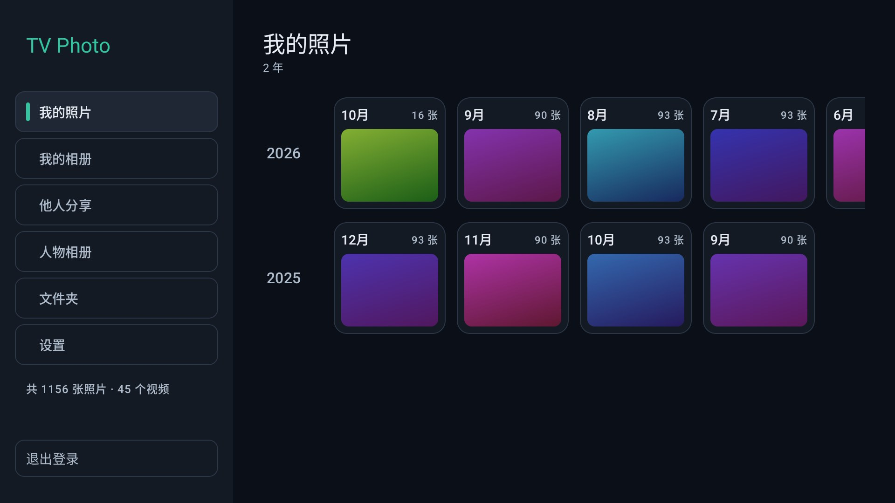

> 想改代码、自己构建、或者想读某一处为什么这么写：[`docs/DEVELOPMENT.md`](docs/DEVELOPMENT.md) 是开发者的入口，
> 它再指向协议逆向笔记、验证记录和各项设计的取舍。这份 README 只讲**功能和怎么用**。

## 界面一览

| | |
| --- | --- |
| **我的照片 · 时间线**<br> | **我的相册**<br>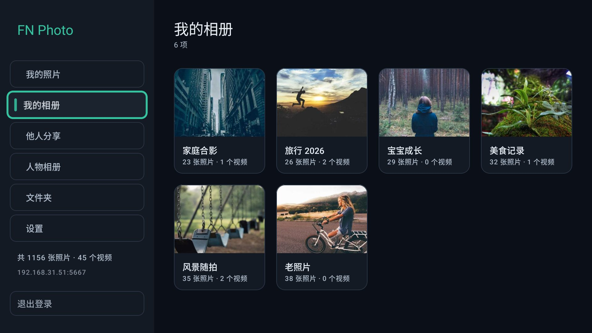 |
| **他人分享**<br>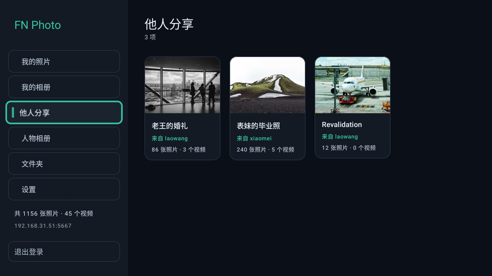 | **人物相册**<br>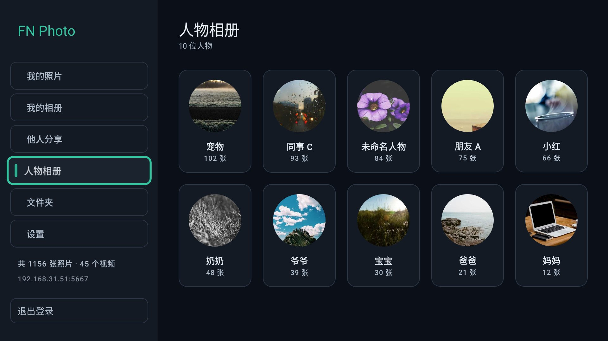 |
| **文件夹**<br>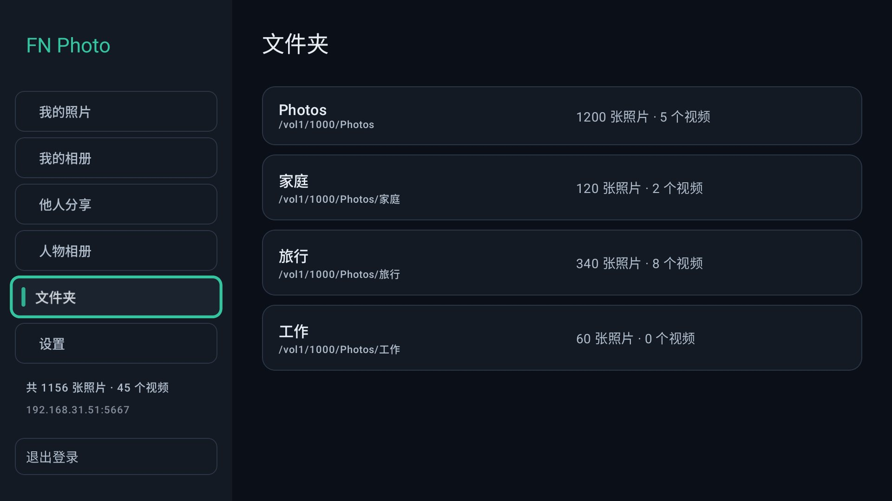 | **某个月的照片网格**<br>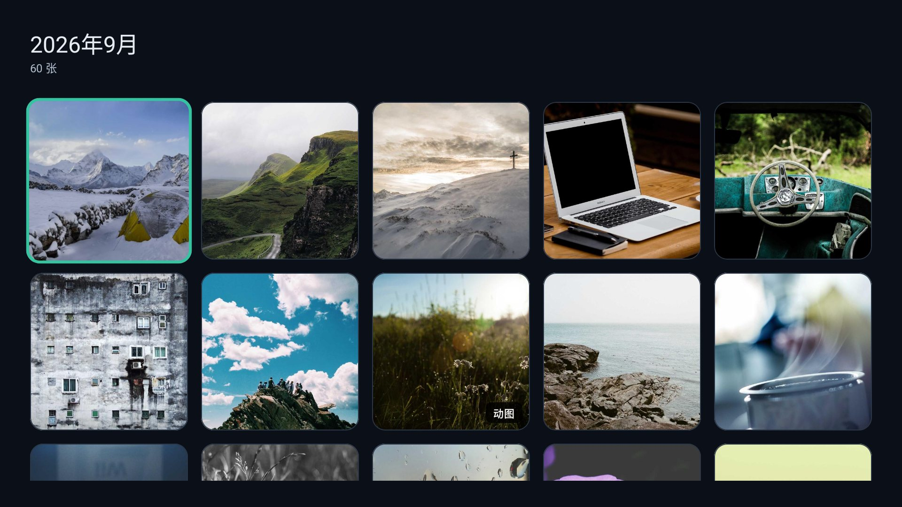 |
| **文件夹里的照片，动图 / 视频角标**<br>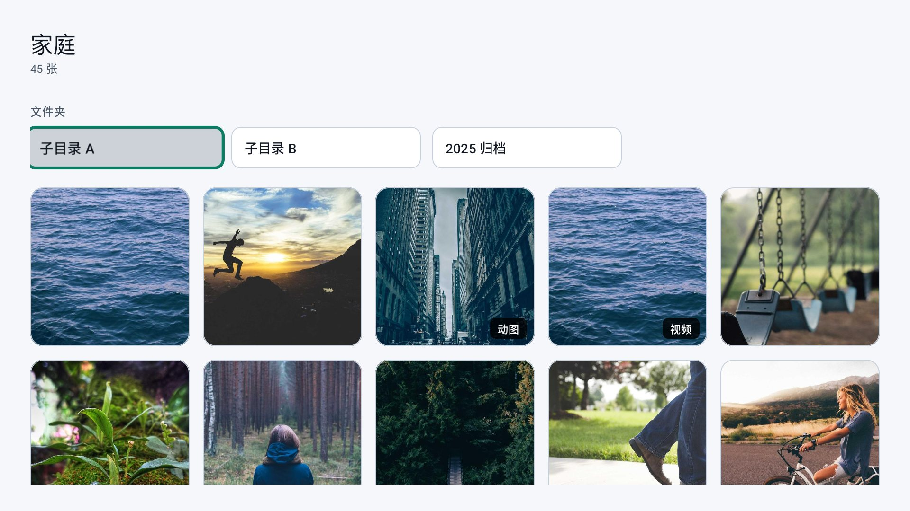 | **大图 + 信息栏**<br> |
| **幻灯片控制条 + 背景音乐列表**<br>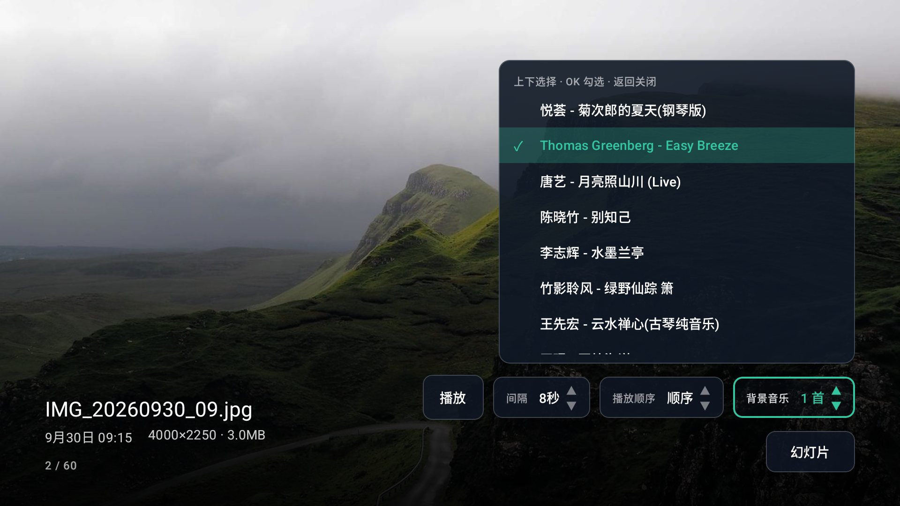 | **翻页排队的箭头**<br> |
| **浅色主题**<br>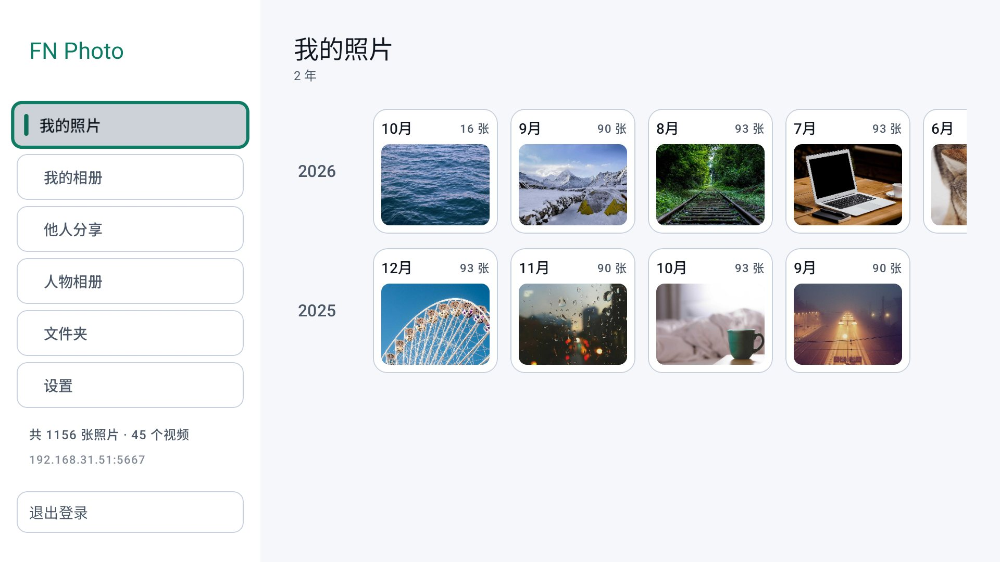 | **设置**<br>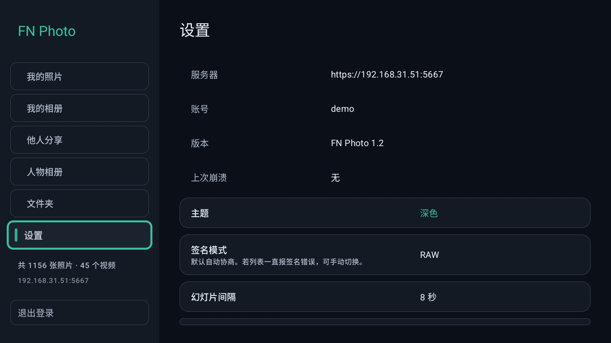 |
| **登录**<br>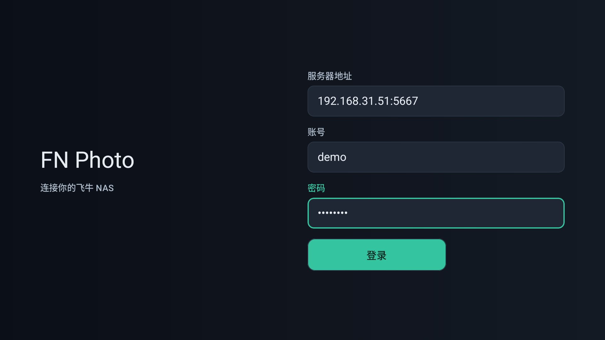 | **查看原图**<br> |

## 功能

浏览：

- **我的照片（时间线）** —— **一年一行，一行里横排这一年的各个月份**。一行以年份开头，随后每个月一张卡片：月份在上，该月第一张照片在下。没照片的月份不出卡片。左右走这一年的月份，上下在年份之间移动。
- **我的相册** —— 用户自建的相册，带封面和照片／视频数量。
- **他人分享** —— NAS 上其他账号分享给你的相册，每张卡片写明来自哪个账号。空列表是正常状态，会如实说明，不提供重试。
- **人物** —— 相册端侧 AI 聚类出的人脸，圆形头像，隐藏的人脸会被过滤掉。空列表是正常状态（AI 索引未开启），会解释原因。
- **文件夹** —— 相册应用托管的文件夹，可逐层进入子文件夹。标题右边的按钮切换**网格／列表**，两种形状都记住，且共用同一个位置记忆。网格卡片带各自的张数；列表不截断，写得出**叫什么、在哪一层**。
- **进入即刷新** —— 选中分区、打开网格时都会重新核对背后的列表，所以别人新分享的相册、刚上传的照片不用重启就会出现。核对失败绝不用错误顶掉屏幕上已有的内容。

看图：

- **全屏查看器** —— 自适应屏幕的照片、左右翻页、信息条，以及幻灯片。
- **翻页绝不清空屏幕** —— 翻页走一个**指针**：按右键把指针往前挪一格，而在指针停下的那张真正下载解码完成之前，屏幕上那张纹丝不动，右下角出现一排呼吸的箭头（指针走过几格就是几个箭头）。**只有指针停下的那一张会被取回**，中间那些既不上屏也不下载。取回的那张一就绪就顶替前一张，中间没有黑帧。
- **照片还没到，不等于黑屏** —— 查看器先显示加载指示器和 加载中…，第一张解码完成就撤掉。翻页从不需要它们：正在离开的那张会一直留在屏幕上。
- **预览原图** —— **设置 → 通用 → 预览原图**有三个选项，按 OK 依次轮转并记住：**是**（所有预览都是原图）、**否**（所有预览都是大缩略图）、**仅用于幻灯片播放**（默认）。缓存里已经有原图的那张，手动翻页也直接用原图。信息条里会写明眼前这张是**原图**还是**缩略图**；是缩略图时角上会多一个 **原图** 按钮，按下去就取全画质，不必改设置。
- **视频和 Live Photo** —— 视频支持拖动进度串流播放；Live Photo 带角标，会播放它的动态片段。
- **记住你看到哪儿** —— 从照片退出回到网格里的那张照片，从网格退出回到那个月份，逐层向上。

幻灯片：

- **幻灯片只走照片** —— 轮播里混进视频会中止推进、还会盖住底下的音乐，所以两种顺序都会跳过视频。视频仍可手动打开。
- **幻灯片设置有两个入口，值是同一份** —— 查看器信息条角上的 **幻灯片** 按钮，以及 **设置 → 幻灯片设置**。间隔（3/5/8/15/30 秒）、顺序（顺序／随机）在两边都能改，改哪边都一样；背景音乐的勾选在查看器的列表和音乐页里都能做，存的也是同一份。
- **幻灯片底下放背景音乐** —— 随幻灯片开始，按列表顺序循环播放勾选的曲目，随幻灯片停止。内置**一首**（随 APK 打包），因为配乐必须和幻灯片同时开始 —— 一首还要先认证、先缓冲的曲子会让每次开场都先来一段静音。
- **自定义背景音乐** —— 内置那首之外可以放你自己的歌，不需要电脑、不需要另装服务端。**上传页**（查看器曲目列表最后一行 `＋ 上传 / 管理背景音乐…`，或 **设置 → 幻灯片设置 → 上传背景音乐**）左边是标题和二维码，右边是**一个带序号的滚动列表**：**手机扫码上传** —— 手机连同一个 Wi-Fi，扫开选 mp3（可多选）一首首传，每传完一首右边**最上面**就多一行、边框**闪两下**告诉你是这一首。列表里 **OK 选中／取消**（选中的才播放），**长按**出「排序 / 删除」两个小按钮：左右切换、OK 执行、Back 退出；点排序后这一行上下出现 ▲▼，上下键把它往上／往下挪一位，Back 确认这个顺序。**序号就是播放顺序**，内置那首也能排序、也能删 —— 它的文件在 APK 里删不掉，所以删除只是从列表里去掉，页面上会多一行 `恢复内置曲目` 把它放回来。传上来的歌存在电视的曲库目录里（页面最下方写着完整路径，用数据线或文件管理器把 mp3 拷进去也一样会出现）；`清空我的音乐` 只删这些拷贝，上限 1 GB、单个文件 40 MB。新加的曲子**不会自动勾选**：勾选会让播放列表从头开始，而"添加"不该打断正在听的东西。
- **聚会模式** —— 正在运行的幻灯片每 **30 秒**重新读一次相册：新增的照片**追加**进轮播（不重新排序，免得正在看的照片被中途换掉），已删除的照片退出轮播。所以同事发进相册的照片不用任何人碰遥控器就会加入。

图评（电视上出二维码，客人扫码写评论，评论以弹幕飘过）：

- 需要一台自己的服务端，见下面的**图评服务端**。
- **照片要先「开图评」才会进服务端**：预览一张照片时按 ↑ 打开信息条，按 **扫码评论** —— 信息条收起、右下角出现二维码、弹幕打开，一次到位。只看照片不会上传任何东西 —— 服务端在你按下之前完全不知道有这张图。
- 已经开过的照片，以后再看会自动认出来并直接显示二维码和弹幕，**不会再上传一次**；换台电视看同一本相册则要各自开一次。
- 弹幕是自动的：服务端手里有这张照片的评论就飘，没有就什么都不显示。二维码那页 H5 就能写：没有 App、不用登录，名字可以留「匿名」。评论立刻以弹幕飘过照片。
- **一整场幻灯片都要出码**：查看器里按 **幻灯片** → 把最后一行 **图评** 打开（默认关）。开着它的放映会边放边登记每一张，适合聚会；关着时只有你手动开过的那几张有码。
- **弹幕数量（关 / 少 / 多）在 设置 → 图评设置**：它同时管字号、轨道数和要不要重播最近几条，**「关」就是不要弹幕**。查看器角上不再有图评菜单 —— 那里只有 **扫码评论** 这一个动作。
- **没填图评服务器（或把 图评 调成「关」）时，扫码评论按钮和幻灯片那一行的 图评 开关根本不画出来**：没有服务器可说的两个控件摆在屏幕上，只是在请人去按一个不会响的按钮。填上地址它们就回来 —— 填地址的地方是 设置 → 图评设置。
- **手机上删掉的评论会从电视上消失**：服务端推的是评论的**状态**，电视按 id 覆盖手里的那一份，已经飘着的那条会飘完这一趟。
- 图评只对照片：视频不出二维码，也没有弹幕层。

设置与其他：

- **设置页分两栏** —— 左侧是分类子菜单（**版本升级 / 通用 / 幻灯片设置 / 图评设置**），右侧是对应的内容，比原来一条长到屏幕外的列表好找得多。焦点走到哪一行，那一行就滚进视野。
- **检测升级** —— **设置 → 版本升级**：进这一页会自己查一次，按 OK 再查一次。查的是 GitHub 和 Gitee 上最新的 release（两个源同时问，取更新的那个）。比自己新时那一行写 **有新版本 x.y.z**，按 OK 开始下载：**先校验哈希，再交给系统安装器**；对不上就删掉、报 安装包校验失败。Android 8 及以上还要「安装未知应用」这项授权，应用会在**下载之前**要。任何一条路走不通时那一行都会给出失败原因和手动路线（release 页面地址）。
- **有新版本时主菜单「设置」上有一个红点** —— 应用启动后就自己查一次，所以不必先打开设置页才知道。
- **深色或浅色** —— **设置 → 通用 → 主题**可以切换整个应用并记住选择。深色是默认，也是昏暗房间里看照片时想要的那个；浅色是给明亮房间的，那时深色界面会变成一面镜子。切换后不用重启。
- **只填地址，只用 HTTPS** —— 登录框接受形如 `192.168.31.14:50317` 的服务器地址；不写端口时用飞牛的安全默认端口 5667。输入 `http://` 会被折叠成 `https://`，凭据绝不会以明文离开电视。
- **NAS 证书首次使用时信任** —— 飞牛提供的是自签名证书，应用首次连接时记住指纹，之后遇到**不同**的指纹会拒绝一次并说明，再按一次 登录 即接受。这类证书有效期约三个月，续期是正常的。
- **访问码** —— 如果飞牛配置了登录入口网关，应用会自己通过这道网关，该输入框只在服务器确实要求时才出现。
- **登录一次就够** —— 凭据在提交时就保存，所以哪怕**失败**的一次尝试（访问码错误、NAS 休眠）也不会让你用遥控器重敲一遍。凭据按**服务器 + 账号**记忆，登录界面把它们作为一键快捷方式提供。
- **登录状态过期会自己恢复** —— 电视放着不动很久、NAS 把会话收回之后，页面上会出现一个 401 和 重试 按钮；重试会像重新登录一样重新建立会话（包括访问码网关），不需要退出登录再登一次。真的恢复不了（比如访问码被改了）才会回到登录界面，并把服务器给的原因写在上面。
- **图片缓存** —— **设置 → 通用 → 清除图片缓存**：上限 **5 GB**，而且不超过设备**剩余空间**的四分之一（电视盒子常常只剩一两 GB，而一个撑满磁盘的缓存在 Android 眼里就是"可以清理的缓存"，清掉之后整本相册又要重下一遍）。LRU 自动淘汰最旧的；只缓存图片，视频是串流播放、不落盘。设置里能看到已用量和**实际生效的上限**，被剩余空间压低时会写明。
- **在电视上崩溃时** —— 未捕获异常会写入 `files/last-crash.txt`，最近一次的首行显示在 **设置 → 通用 → 上次崩溃**，拿着遥控器的人可以念出来。

## 遥控器操作

| 按键 | 时间线／相册／文件夹 | 查看器 |
| --- | --- | --- |
| 方向键 | 移动焦点 | — |
| ← / → | — | 上一张／下一张照片；展开了一行（幻灯片的设置行、或图评的三行开关）、或角上有两个以上按钮时，改为在这些控件之间走 |
| ↑ / ↓ | — | 显示／隐藏信息条；打开后 ↑/↓ 在角上的控件之间走：原图 → 图评 → 幻灯片 → 收起信息条；选中设置控件时改变其值 |
| OK | 打开焦点所在项 | 开始／暂停幻灯片（视频为播放／暂停）；信息条展开时操作高亮的那个控件 |
| Back | 返回上一层 | 展开的那一行开着时先收起它，否则离开查看器 |
| Back ×2 | 退出应用（在顶层时） | — |

设置页是两栏：上下在左侧分类之间移动，移到哪个分类右侧就换成哪一页，右键进入右侧的选项，左键回到分类。

## 环境要求

- Android TV 或电视盒子，系统 **Android 6.0（API 23）** 或更高。
- 局域网内可通过 **HTTPS** 访问的飞牛 NAS，且相册服务已运行 —— 它的安全 Web 端口，作者 NAS 上是 50317，默认为 5667。应用没有明文模式，NAS 的自签名证书首次使用时信任（见上）。
- 飞牛账号必须能读取照片。**文件夹**下面显示的是相册应用**托管的文件夹**；列表为空时请在飞牛里添加。

## 安装

已经签名打包好的 APK 挂在 GitHub Release 上，直接下载就行，不必自己构建：

**<https://github.com/kungfucode-rex/fn-tv-photo/releases/latest>** —— `FN-tvphoto-1.5.6.apk`，约 16 MiB。
国内网络下更稳的同一份发布在 Gitee：**<https://gitee.com/kungfucode/fn-tv-photo/releases/latest>**。

装到电视上：

```bash
adb install -r FN-tvphoto-1.5.6.apk
```

装好之后也可以让应用自己升级：**设置 → 版本升级 → 检测升级**，或者在主菜单上看到「设置」旁边的红点时进去看看。

同一个 APK 也能装在手机上，带一个普通的桌面图标 —— 界面仍是强制横屏、以方向键为先的电视布局。

想自己构建、发布测试版、或者往电视上装 debug 包：见 [`docs/DEVELOPMENT.md`](docs/DEVELOPMENT.md)。

## 图评服务端（Docker 部署）

电视上那个「图评」按钮 —— 预览照片时角落出现二维码，客人扫码在手机上写评论，评论以弹幕飘回电视 ——
需要一个服务端。它在 [`server/`](server/README.md)：一个静态 Go 二进制，自带 H5 评论页，全部状态就是
`data/` 里的一个 SQLite 文件和一个缩略图目录。

**部署者唯一需要填的值是管理员口令**，其余都有默认值。更细的说明（环境变量全表、签名密钥、地址规则、从源码构建）在 [`server/README.md`](server/README.md)。

### 需要什么

- 一台跑 Docker 的机器（飞牛 / 群晖 / 威联通 / 任何 Linux），**和电视、手机在同一个局域网里**；
- 电视上先装好 FN Photo（见上面的**安装**）；
- 一个空闲端口（默认 8080）和一个目录（放数据）。

**这个端口不要映射到公网。** 它除了一个管理员口令没有账号体系、评论对所有能连到它的人可见，局域网是它的设计边界。

### 一份文件就够（推荐）

镜像发布在 Docker Hub，而且是**多架构**的：amd64 还是 arm64 由镜像自己的清单决定 —— 不用挑二进制、不用管 Dockerfile、也不用在同一个目录里凑文件。

飞牛 **Docker 应用 → Compose → 新增项目**：项目名 `tuping`，把下面这段粘进去，把 `TUPING_ADMIN_TOKEN` 换成你的口令，点**启动**（这条路**没有「构建」**，只是把镜像拉下来）：

```yaml
services:
  tuping:
    image: "kungfucode/tuping:0.1.3"
    container_name: "tuping"
    restart: "unless-stopped"
    ports:
      - "8080:8080"
    volumes:
      - "./data:/data"
    environment:
      TUPING_ADMIN_TOKEN: "change-me"
```

`8080` 左边那个是 NAS 上的端口（被占用就改成 `8090:8080` 之类，电视和手机上用的地址也跟着带端口）；
`./data` 是评论、缩略图、签名密钥落地的目录；`container_name` 让容器就叫 `tuping`（下面那些
`docker exec tuping …` 用的是这个名字）。

> **这段每行都很短、每个值都带引号，是有意的**：从渲染过的页面复制时，有些工具会按窗口宽度重排长行，
> 而且在**未加引号**的值里按 `:` 和 `-` 断行 —— `kungfucode/tuping:0.1.3` 会变成两行、
> `unless-stopped` 会变成 `unless-` + `stopped`，整段就解析失败。引号里的内容不会被拆，所以值一律加引号。
> 不想冒这个险就别粘：用文件管理把 [`server/docker-compose.image.yml`](server/docker-compose.image.yml)
> 传进一个目录、在面板里按**路径**建项目，或者直接用下面那条命令。

没有 Compose 的场合，等价的一条命令：

```sh
docker run -d --name tuping --restart unless-stopped -p 8080:8080 \
  -v "$PWD/data:/data" -e TUPING_ADMIN_TOKEN='你的口令' kungfucode/tuping:0.1.3
```

| 变量 | 填什么 |
| --- | --- |
| `TUPING_ADMIN_TOKEN` | 管理员的口令，登录 `/admin` 时手打；**留空 = 没有管理员**（页面上不会出现「管理员登录」） |

其余都有默认，不用管：`TUPING_SECRET`（签名密钥）第一次启动自己生成并存进 `data/`；`TUPING_BASE_URL`
（二维码里的地址）默认取"谁在连"的那个地址 —— 二维码里的地址本来就是电视注册照片时上报的那个。

### 三步验收

1. **看日志**：容器起来后，日志里应该有这两行 —— 少了任何一行都是出问题了：

   ```
   level=INFO msg="running unprivileged" uid=10001 gid=10001
   level=INFO msg="tupingd listening" addr=[::]:8080 ... db=/data/tuping.db
   ```

2. **问服务**：`curl http://<NAS 地址>:8080/healthz` → `{"ok":true,"version":"0.1.3",...}`。
3. **进管理页**：手机打开 `http://<NAS 地址>:8080/admin`，用第 2 步那个口令登录，能看到审核队列就好。

然后电视：**设置 → 图评设置 → 图评服务器**填**同一个地址**（`http://192.168.31.14:8080` 这种，手机也得能打开它），预览一张照片 → 按 ↑ → **扫码评论**（二维码出现）→ 手机扫码写评论 → 电视上弹幕飘过。

### 出问题时

| 症状 | 是什么 / 怎么办 |
| --- | --- |
| 拉镜像慢、失败，看到 `401`、`403` 或 `connection reset` | NAS 的镜像源问题。**有些加速源只镜像官方镜像**：`docker.1panel.live`、`docker.xuanyuan.me` 拉 `library/alpine` 没问题，拉本镜像会回 `403`。实测能拉本镜像的有 `https://dockerproxy.net`、`https://hub.1panel.dev`。在 Docker 应用的**镜像 → 仓库设置**里两类各放一个，然后**把 Docker 服务停止再启动**，再启动项目。 |
| 容器反复重启，日志 `unable to open database file` | 数据目录的属主和容器里的 uid 对不上。镜像自己会处理，只有挂载在 SMB/CIFS 这类不支持 `chown` 的地方，才需要给服务加一行 `user: "0:0"`。 |
| 起不来，`port is already allocated` | 8080 被别的容器占了：把 `"8080:8080"` 左边改掉（例如 `"8090:8080"`），电视和手机上用的地址也要跟着带端口。 |
| 二维码扫了打不开 | 二维码里的地址是电视上报的：先在电视上确认那行地址**手机也能打开**，然后在电视上重新注册这张照片。 |
| 配了 HTTPS，但 http 照常、https 连不上 | 按顺序查两件事：① 在容器里跑 `/usr/local/bin/tupingd -check`，**输出里根本没有 `tls` 那一行** = 这个二进制不认识 TLS（0.1.1 起才有），把镜像 tag 换成 0.1.3 或自己构建；② 有 `tls` 却仍是 `off` = 环境变量没进容器：改完 compose 必须点**「启动 / 重新部署」**，只点「重启」不算。 |
| 配了 HTTPS 之后容器一直 unhealthy | 旧 compose 里那句健康检查是 `wget http://127.0.0.1:8080/healthz`，TLS 下必然失败 —— 服务没坏。换成二进制自己的探针：`test: ["CMD", "/usr/local/bin/tupingd", "-health"]`。 |
| 页面上写「发得太快了，歇一会儿」（HTTP 429） | **限流生效了，不是故障。** 等一分钟、或换一张照片就恢复；全表与理由在 [`docs/tuping-design.md`](docs/tuping-design.md) §7。 |
| 电视上扫码提示「这张照片不在图评里」 | 电视上那张码是**上一台服务器**签发的（服务端重装、换了 `data/` 目录之后）。1.4.11 起应用会自己走出来；更早的版本重启一次应用即可。想让评论不丢就不要换 `data/` 目录。 |

### 要 HTTPS 的话

上面那份 compose 加三处就有 HTTPS（域名、端口映射、证书申请与续期都由你决定怎么做 —— ACME 客户端、反代、隧道都行）：

```yaml
    ports:
      - "443:8080"
    volumes:
      - "./certs:/certs:ro"
    environment:
      TUPING_TLS_CERT: "/certs/fullchain.pem"
      TUPING_TLS_KEY: "/certs/privkey.pem"
```

（`443:8080` 的左边是 NAS 上的端口，手机上不用再写端口；`./certs` 放证书和私钥，要能被 uid 10001 读到。）
然后电视上把**图评服务器**改成 `https://你的域名`。

两个坑值得先知道：**两个变量必须成对**（只设一个会启动失败并点名缺的那个，不会悄悄退回明文）；**自签证书对客人没用** —— 二维码是给别人的手机扫的，微信会拦住不受信任的证书，想要绿锁就得是真证书。全部细节在 [`server/README.md`](server/README.md) 的 **HTTPS** 一节。

### 升级 / 备份 / 卸载

- **升级**：把 compose 里的镜像 tag 换成新版本，点「启动 / 重新部署」—— 只点「重启」不会换镜像，**也不会把新的环境变量装进容器**。
- **备份**：`data/` 里三样东西 —— `tuping.db`（评论）、`thumbs/`（缩略图）、`secret`（签名密钥）。前两个必须备。
- **卸载**：停掉项目、删掉容器；想连评论一起清掉就删 `data/` 目录。

## 更多文档

| 想了解 | 看 |
| --- | --- |
| 功能怎么用、怎么装、服务端怎么部署 | 这份 README |
| 改代码、构建、跑测试、发布、模拟器与 mock | [开发文档](docs/DEVELOPMENT.md) |
| 每一项功能是怎么验证的、踩过哪些坑 | [验证记录](docs/verification.md) |
| 飞牛相册接口的逆向笔记（含证据） | [协议笔记](docs/fnos-photo-api.md) |
| 图评的协议与决策（唯一真相源） | [图评设计](docs/tuping-design.md) |
| 自定义背景音乐：曲库、扫码上传、目录扫描 | [自定义音乐设计](docs/custom-music-design.md) |
| 图评服务端自己的文档 | [服务端文档](server/README.md) |
| 让 agent / 新同事快速了解这个项目 | [AGENTS.md](AGENTS.md) |
